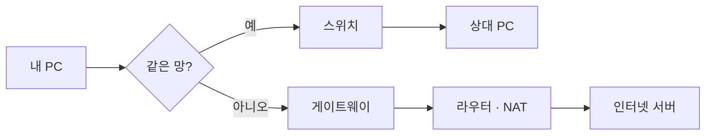
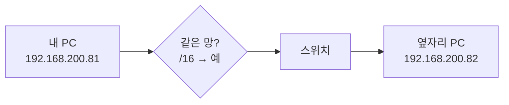

# 아침 과제 13 · 패킷이 어디로 가는지 그림으로 — 같은 망 · 다른 망 · VPN

10월 19일 (월) · 아침 과제

**오늘 하는 일:** 지난주에 IP 주소 · 마스크 · 스위치 · 게이트웨이 · 라우터 · NAT · VPN · 방화벽을 하루에 하나씩 배웠습니다. 오늘은 이것들을 **그림 한 장의 길**로 잇습니다. 먼저 모든 상황이 지나가는 **뼈대 그림**을 그리고, 상황마다 그 뼈대에서 **지나간 길만** 남긴 그림을 AI 와 함께 그립니다.

그림 하나는 **질문 하나**에만 답합니다 — 「이 패킷은 어디로 가나?」. 상자는 **5개 이하**(상황 4 만 6개)로, 상자 안에는 장비 이름 하나만 씁니다.

**오늘 못 끝냈으면 오후 5시 이후에 마무리합니다.**

---

## 1. 용어 네 개를 찾아 한 줄로 적습니다

**왜 중요한가** — 뼈대 그림의 상자 이름이 이 네 개입니다. 뜻을 내 말로 한 줄씩 적어 두어야 AI 가 그린 그림이 맞는지 판단할 수 있습니다.

| 용어 | 찾을 것 | 검색어 예시 |
|---|---|---|
| 같은 망 판정 | 서브넷 마스크로 두 주소가 같은 망인지 어떻게 정하나 | `서브넷 마스크 같은 네트워크 판단` |
| 스위치 | 같은 망 안에서 무엇을 보고 어디로 전달하나 | `스위치 MAC 주소 테이블` |
| 기본 게이트웨이 | 다른 망으로 갈 때 왜 여기로 보내나 | `기본 게이트웨이 역할` |
| 라우터 · NAT | 다른 망 사이를 무엇으로 전달하고, 사설 주소를 어떻게 바꾸나 | `라우터 NAT 역할` |

4번의 기록 파일 「용어」 칸에 한 줄씩 적습니다. 10/13 안내 문서를 다시 열어 봐도 됩니다.

---

## 2. 뼈대 그림을 그립니다

**왜 중요한가** — 오늘의 모든 상황은 이 그림 하나 위를 지나갑니다. 상황마다 새로 외우지 않고 「뼈대에서 어느 길로 갔나」만 정하면 됩니다.

뼈대 그림은 이렇게 생겼습니다. 이 모양 그대로 4번의 기록 파일에 넣습니다.



- **mermaid** (머메이드) — 글자로 그림을 그리는 문법. 깃허브는 md 파일 안의 ` ```mermaid ` 상자를 그림으로 보여 줍니다.
- `[ ]` 는 네모 상자, `{ }` 는 마름모(판정), `-->` 는 화살표, `-- 예 -->` 는 글자가 붙은 화살표입니다.

---

## 3. 상황마다 지나간 길을 그립니다

**왜 중요한가** — 「같은 망인가, 다른 망인가」를 먼저 판정하는 습관이 생기면, 접속이 안 될 때 어느 장비부터 확인할지 바로 정할 수 있습니다. 관제에서 로그가 어느 장비에 남는지도 이 길로 정해집니다.

**상황마다 하는 일**

1. **[AI]** 아래 상황 문장과 뼈대 그림을 AI 에게 주고, mermaid `flowchart LR` 로 **지나간 길만** 그려 달라고 합니다. 상자는 5개 이하로 해 달라고 합니다.
2. **[나]** 상황의 「꼭 들어갈 상자」와 비교합니다. 빠졌거나 틀린 상자(예: 같은 망인데 게이트웨이가 들어 있음)는 내가 고칩니다.
3. **[기록]** 그림 아래에 「왜 이 길인가」 한 줄과 「AI 가 틀린 곳 · 내가 고친 것」 한 줄을 씁니다. AI 가 틀리지 않았으면 「없음」이라고 씁니다.

학원 PC 의 값: 내 PC `192.168.200.81`, 마스크 `255.255.0.0`(`/16`), 게이트웨이 `192.168.1.1`. 내 PC 의 실제 값은 `ipconfig` 로 볼 수 있습니다.

### 상황 1 · 옆자리 PC 에 `ping` 을 보낸다 — 본보기

옆자리 PC 는 `192.168.200.82` 입니다. 이 상황은 본보기로 그림을 미리 보여 드립니다.



- **왜 이 길인가:** 마스크 `/16` 으로 보면 네트워크 부분이 둘 다 `192.168` 이라 같은 망이고, 게이트웨이를 거치지 않고 스위치가 바로 전달한다.

### 상황 2 · 내 PC 에서 `naver.com` 을 연다 — 필수

| 꼭 들어갈 상자 | 같은 망? (아니오) · 게이트웨이 · 라우터 · NAT · 네이버 서버 |
|---|---|
| 「왜 이 길인가」에 넣을 것 | `nslookup naver.com` 으로 받은 IP 가 내 PC 와 같은 망인지 |

### 상황 3 · 집에서 VPN 을 켜고 회사 업무 포털에 접속한다 — 필수

10/15 의 회사입니다: 집 공인 IP `211.36.10.7` → 회사 VPN 게이트웨이 → VPN 주소 `10.8.0.21` 로 사내망에 들어가 → 방화벽 → 업무 포털 `10.10.20.5:443`.

| 꼭 들어갈 상자 (6개까지) | 집 PC · 집 게이트웨이(공유기) · VPN 게이트웨이 · 방화벽 · 업무 포털 |
|---|---|
| 「왜 이 길인가」에 넣을 것 | 방화벽이 몇 번 규칙에 맞아 허용했는지(10/15 오후 규칙표 R) |

---

## 4. 기록하고 올립니다

**왜 중요한가** — 그림을 깃허브에 올리면 mermaid 가 실제 그림으로 보여서, 내가 쓴 문법이 맞았는지 바로 확인됩니다. 올리기는 10/12 에 배운 순서 그대로입니다.

1. **[터미널]** 지금 위치를 확인합니다.
   ```bash
   pwd
   ```
   결과가 `…/security-agent-toolkit` 으로 끝나면 아래 `touch` 를 칩니다. **그 위치가 아니면 `touch` 하지 말고 `cd` 로 먼저 옮깁니다.**
   - `…/security-agent-toolkit/network_zt` 처럼 더 안쪽이면 → `cd ..` (`security-agent-toolkit` 이 나올 때까지)
   - 옮긴 뒤 `pwd` 를 다시 쳐서 `…/security-agent-toolkit` 으로 끝나는지 확인합니다.
   ```bash
   touch docs/2026-10-19.md
   ls docs
   ```
2. **[VS Code]** 왼쪽 목록에서 `docs/2026-10-19.md` 를 열고 아래 틀을 붙여 넣어 채웁니다. 그림 칸에는 AI 와 함께 만든 mermaid 를 ` ```mermaid ` 줄과 ` ``` ` 줄 사이에 넣습니다.

````markdown
# 2026-10-19 (월)

## 용어
- 같은 망 판정:
- 스위치:
- 기본 게이트웨이:
- 라우터 · NAT:

## 뼈대 그림


## 상황 1 · 옆자리 PC 에 ping

- 왜 이 길인가: 마스크 /16 으로 보면 네트워크 부분이 둘 다 192.168 이라 같은 망이고, 게이트웨이를 거치지 않고 스위치가 바로 전달한다.

## 상황 2 · naver.com 접속
```mermaid

```
- 왜 이 길인가:
- AI 가 틀린 곳 · 내가 고친 것:

## 상황 3 · 집에서 VPN 으로 업무 포털
```mermaid

```
- 왜 이 길인가:
- AI 가 틀린 곳 · 내가 고친 것:

## 막힌 것

## 다음에 확인할 것
````

3. **[터미널]** 10/12 에 배운 순서로 올립니다. `git status` 의 빨간 목록에 `docs/2026-10-19.md` 하나만 보이면 다음으로 갑니다. `.env` 가 보이면 멈추고, `.gitignore` 에 `.env` 한 줄이 있는지 확인한 뒤 `git status` 를 다시 합니다.

```
git status
git add .
git commit -m "Add 10/19 network flow diagrams"
git push
```

---

## 5. 깃허브에서 그림을 확인합니다

**왜 중요한가** — mermaid 는 글자 하나만 틀려도 그림이 그려지지 않습니다. 깃허브 화면에서 그림이 보여야 끝난 것입니다.

1. **[브라우저]** 내 `security-agent-toolkit` 저장소에서 `docs/2026-10-19.md` 를 엽니다.
2. 글자 대신 **상자와 화살표 그림**이 보이는지 봅니다.
3. 그림 대신 빨간 오류 문구가 보이면, 그 그림의 괄호 짝(`[ ]` · `{ }` · `" "`)과 화살표(`-->`)를 확인해 고치고 4번의 `git add .` 부터 다시 올립니다.

VS Code 의 미리보기(`Ctrl + Shift + V`)에서는 mermaid 가 그림으로 보이지 않고 글자로 보일 수 있습니다. 그림 확인은 깃허브에서 합니다.

---

## 6. 확인합니다

**왜 중요한가** — 빠진 단계를 여기서 찾아 마무리합니다. 오늘 그린 길은 이번 주 Zero Trust 에서 「확인하는 장치를 길의 어디에 둘까」를 정할 때 다시 씁니다.

- [ ] 용어 네 개를 내 말로 한 줄씩 적었다
- [ ] 뼈대 그림과 상황 1 · 2 · 3 의 그림을 넣었다
- [ ] 상황 2 · 3 마다 「왜 이 길인가」와 「AI 가 틀린 곳 · 내가 고친 것」을 적었다
- [ ] 그림마다 상자가 5개 이하(상황 3 은 6개 이하)다
- [ ] 깃허브에서 그림이 그림으로 보인다

---

## ⭐ 다 한 사람만 합니다

**왜 중요한가** — 같은 건물 안의 PC 라도 다른 망일 수 있습니다. 상황 1 과 무엇이 다른지 그림으로 비교하면 「같은 건물 = 같은 망」이라는 오해가 풀립니다.

**상황 4 · 같은 건물 다른 층 개발팀 PC(다른 VLAN)에 접속한다.** 개발팀은 VLAN 20, 나는 VLAN 10 입니다(10/13 오후).

1. 상황 4 를 같은 방법으로 그려 `docs/2026-10-19.md` 맨 아래에 더합니다.
2. 그림 아래에 「상황 1 과 다른 점」 한 줄을 적습니다.
3. 4번의 `git add .` 부터 메시지만 `"Add situation 4"` 로 바꿔 다시 올립니다.
