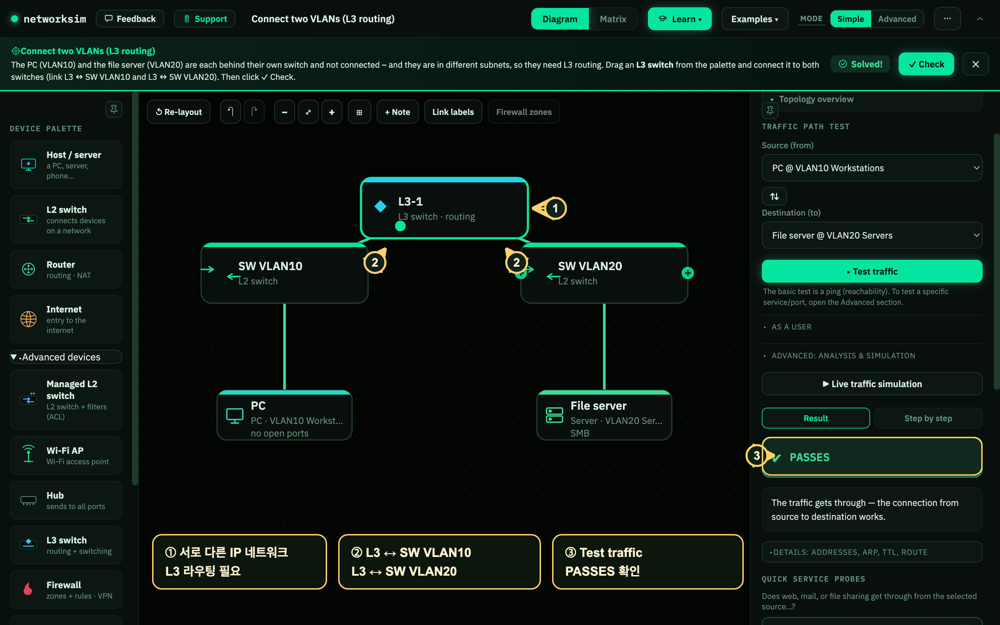

# 아침 과제 13 · 다른 VLAN 연결하기 — L3 스위치 (networksim · v2)

10월 19일 (월) · 아침 과제 · 30분

**오늘 하는 일:** 서로 다른 네트워크에 있는 PC 와 파일 서버 사이에 L3 스위치를 놓고, 통신 시험이 통과하는지 확인합니다.

**용어:** IP(아이피, 네트워크 주소) · VLAN(브이랜, 네트워크를 나눈 가상 구역) · L2(엘투, 같은 IP 네트워크 안에서 장치를 연결) · L3(엘쓰리, 다른 IP 네트워크 사이에서 통신을 전달). 라우팅은 목적지까지 전달할 경로를 정하는 일입니다.

**오늘 못 끝냈으면 오후 5시 이후에 마무리합니다.**

---

## 1. 과제를 엽니다

**왜 중요한가** — 미리 준비된 과제를 열면 장치를 처음부터 만들지 않고, 네트워크 연결 문제를 살펴볼 수 있습니다.

1. **[브라우저]** 주소창에 `https://networksim.app/?task=inter-vlan` 을 입력합니다.
2. **[networksim 창]** 위쪽 과제 이름이 **Connect two VLANs (L3 routing)** 인지 확인합니다.
3. **[networksim 창]** 오른쪽 **Source (from, 출발지)** 는 `PC @ VLAN10`, **Destination (to, 목적지)** 는 `File server @ VLAN20` 인지 확인합니다.

## 2. 연결 전 결과를 확인합니다

**왜 중요한가** — 바꾸기 전 결과를 확인해 두면, 장치를 추가한 뒤 무엇이 달라졌는지 비교할 수 있습니다.

1. **[networksim 창]** 오른쪽의 **Test traffic**(통신 시험) 을 누릅니다.
2. **[networksim 창]** 통신이 실패하는지 확인합니다. 예시 화면에는 `There is no path between the networks – a link is missing.` 라고 나옵니다.
3. **[기록]** 실패 메시지나 실패한 시험의 이름을 적어 둡니다.

## 3. L3 스위치를 놓고 연결합니다

**왜 중요한가** — 두 장치는 서로 다른 IP 네트워크에 있습니다. 다른 네트워크 사이의 통신에는 L3 라우팅이 필요합니다.

1. **[networksim 창]** 왼쪽 **Advanced devices**(고급 장치) 를 펼칩니다.
2. **[networksim 창]** **L3 switch** 를 가운데 작업 화면으로 끌어 놓습니다.
3. **[networksim 창]** 새 L3 스위치를 `SW VLAN10` 과 연결합니다. 장치 옆의 `+` 연결점을 끌어 상대 장치에 놓습니다.
4. **[networksim 창]** 새 L3 스위치를 `SW VLAN20` 과도 연결합니다.
5. **[networksim 창]** L3 스위치가 양쪽 L2 스위치에 각각 연결되어 있는지 그림에서 확인합니다.

## 4. 통신 시험을 다시 합니다

**왜 중요한가** — **Test traffic** 은 기본 연결 시험인 ping(핑, 연결 가능 여부 확인)을 하고, **Check** 는 과제에서 요구한 통신을 채점합니다. 둘 다 확인해야 합니다.

1. **[networksim 창]** Source 가 `PC @ VLAN10`, Destination 이 `File server @ VLAN20` 인지 확인하고 **Test traffic** 을 누릅니다. 결과에 **PASSES** 가 보이는지 확인합니다.
2. **[networksim 창]** 위쪽 **✓ Check** 를 누릅니다.
3. **[networksim 창]** `Solved!`(해결 완료) 와 `PC → server (SMB 445) passes` 가 보이면 완료입니다. SMB(에스엠비)는 파일 공유 서비스이고, 과제는 445번 통신을 확인합니다.
4. **[기록]** 통신 시험 결과와 과제 확인 결과를 각각 적습니다.

## 5. 기록 파일을 만들고 올립니다

**왜 중요한가** — 실패 원인과 바꾼 연결, 확인 결과를 남기면 다른 네트워크 문제를 점검할 때 근거로 쓸 수 있습니다.

1. **[Git Bash]** `security-agent-toolkit` 폴더에서 기록 파일을 만들고 확인합니다.
   ```bash
   pwd                            # 현재 폴더를 확인합니다. security-agent-toolkit 로 끝나야 합니다
   cd ..                          # network_zt 안에 있다면 한 단계 올라갑니다. 이미 루트면 건너뜁니다
   touch docs/2026-10-19.md       # 오늘 기록 파일을 만듭니다
   ls docs                        # 파일이 보이는지 확인합니다
   ```
2. **[VS Code]** `docs/2026-10-19.md` 를 열고 아래 내용을 채웁니다.

````markdown
# 2026-10-19 (월)

## networksim · 다른 VLAN 연결하기
- 연결 전 시험 결과:
- 추가한 장치:
- 연결한 장치:
- 연결 후 시험 결과:
- 서로 다른 네트워크 사이에 필요했던 기능:

## 막힌 것

## 다음에 확인할 것
````

3. **[Git Bash]** `git status` 에 `docs/2026-10-19.md` 만 보이는지 확인합니다. `.env` 나 `.venv` 가 보이면 멈추고, `.env` 는 `.gitignore` 에 있는지 확인합니다.
4. **[Git Bash]** 안전한 파일만 목록에 있는 것을 확인한 뒤 올립니다.
   ```bash
   git add .
   git commit -m "Add 10/19 inter-VLAN networksim note"
   git push
   ```
5. **[브라우저]** 내 `security-agent-toolkit` GitHub 저장소에서 `docs/2026-10-19.md` 가 보이는지 확인합니다.

## 확인합니다

- [ ] 연결 전 PC 와 파일 서버 사이의 통신이 실패했다
- [ ] L3 스위치를 양쪽 L2 스위치에 연결했다
- [ ] `PC → server (SMB 445) passes` 를 확인했다
- [ ] 기록을 GitHub 에 올렸다

## 정답 화면

먼저 직접 풀어 본 뒤 아래 화면을 확인합니다.


